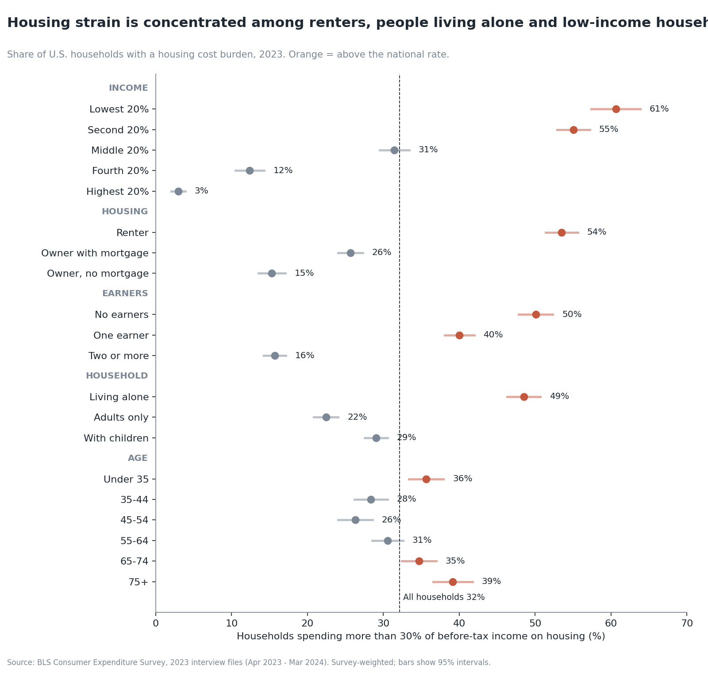
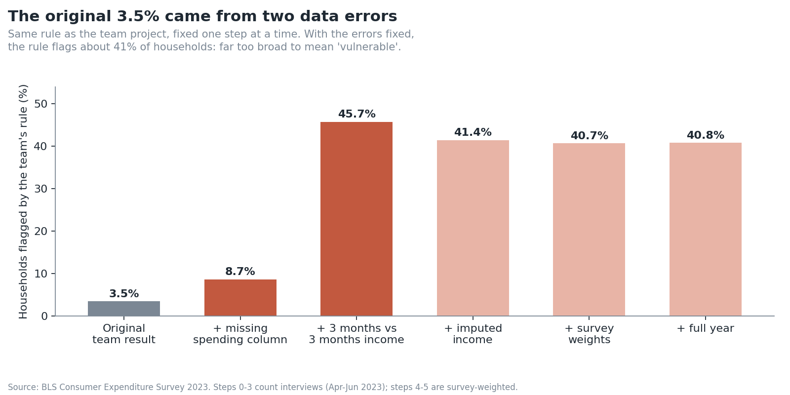
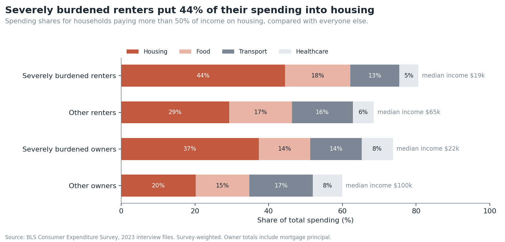

# Which U.S. Households Are Financially Stretched? (2023)

**Real, public data:** U.S. Bureau of Labor Statistics (BLS) Consumer Expenditure Survey, 2023 interview files: 18,871 interviews with 10,344 households, weighted to represent 134.6 million U.S. households.

## The question
Which U.S. households spend so much on housing that the rest of their budget is squeezed, and what do those households have in common?

I use the standard U.S. Department of Housing and Urban Development (HUD) definition:
- a household is **cost burdened** when housing costs take more than **30%** of before-tax income
- it is **severely burdened** above **50%**

## Why I rebuilt this
This started as our team capstone for DAV 6150 (Katz School, Yeshiva University), which used the April–June 2023 file. Revisiting it, I found that its headline number was produced by two data errors:

1. **Missing spending.** The survey splits each household's 3 months of spending across a "this quarter" and a "last quarter" column, depending on the interview month. The project used only "this quarter", so every household interviewed in April showed **$0 spending**: 1,582 of 4,751 households.
2. **Mismatched periods.** Spending covered 3 months, but income covered 12, so every spending-to-income ratio was about 4 times too small.

I reproduced the original result exactly (152 of 4,393 households, 3.46%), then fixed one thing at a time:

| Step | Change | Flagged |
|---|---|---|
| 0 | Original method | 3.5% (152 of 4,393) |
| 1 | Add the "last quarter" spending columns | 8.7% |
| 2 | Compare 3 months of spending with 3 months of income | 45.7% |
| 3 | Use BLS-imputed income, so households that didn't report income are kept | 41.4% |
| 4 | Apply survey weights | 40.7% |
| 5 | Use the full year | 40.8% |

Once the errors are fixed, the original rule flags about **41% of U.S. households**. That is far too broad to mean "vulnerable", so this version uses the standard HUD definition instead.

## Results

| | Share of households | 95% interval | Households |
|---|---|---|---|
| **Housing cost burden** (> 30% of income) | **32.1%** | 30.9 – 33.4 | 42.2 million |
| **Severe burden** (> 50%) | **15.5%** | 14.6 – 16.3 | 20.4 million |
| Renters, cost burdened | 53.5% | 51.4 – 55.6 | 23.6 million |
| Renters, severely burdened | 28.3% | 26.3 – 30.3 | 12.5 million |
| Owners, cost burdened | 21.3% | 20.0 – 22.6 | 18.6 million |

**Who is most affected** (share cost burdened):
- **Income:** 61% of the lowest-income fifth, compared with 3% of the highest fifth.
- **Housing:** 54% of renters, 26% of owners with a mortgage, and 15% of owners without one.
- **Earners:** 50% of households with no earner, 40% with one, and 16% with two or more.
- **Household type:** 49% of people living alone, compared with 22% of adult-only households.
- **Age:** U-shaped. 36% of households headed by someone under 35 and 39% of those 75 and over, against 26% at ages 45–54.

**Where the money goes.** Severely burdened renters (median income $19k) put **44%** of their spending into rent and utilities, compared with 29% for other renters (median income $65k). Their food share is about the same (18% vs 17%), so the extra housing cost comes out of transport and everything else.

## How I checked the numbers
- **Against published BLS figures:**
  - Average income before tax: $102,411 vs $101,805 published (+0.6%).
  - Number of households: 134.57M vs 134.56M.
  - Average spending: $75,282 vs $77,280 (−2.6%). These interviews cover January 2023 – February 2024, not calendar 2023.
- **Against a different survey:** the 2023 American Community Survey (ACS), as tabulated by the Congressional Research Service, reports:
  - 49.5% of renters burdened (this project: 53.5%)
  - 26.5% severely burdened (28.3%)
  - 23.6% of owners burdened. Here, owners come out at 21.3% excluding insurance and repairs and 28.2% including both; insurance can't be separated from repairs in this file.

  The ACS counts 42.9 million burdened households in total; this project finds 42.2 million.
- **Margins of error:** every share has a 95% interval from the survey's 44 replicate weights. The original project dropped these columns.
- **Threshold sensitivity:** the overall rate moves from 40.8% at a 25% threshold to 15.5% at 50%. At the 50% threshold the same groups stand out: renters, people living alone, households with no earner and those aged 75 and over (`results/by_group.csv`).
- **Reproducibility:** `./run_all.sh` gives byte-identical output on every run.

## A measure I tested and rejected
I also tested **"spent more than after-tax income"**: 36.5% of households, even after removing car purchases. But it was highest among:
- households aged 75 and over (50%)
- households with no earner (61%)
- the lowest-income fifth (63%)

That pattern matches two known features of this survey, not hardship: retirees spending savings (which don't count as income) and under-reported income at the bottom. So I report it here but don't use it as a vulnerability measure.

## Recommendations
1. **Target housing help at renters.** 12.5 million renter households pay more than half their income for housing: 28%, against 7% of owners without a mortgage.
2. **Use simple screening questions.** "How many earners live here?" and "Do you live alone?" separate high-risk households (about half burdened) from low-risk ones (16% with two or more earners). Both are easy to collect, unlike income.
3. **Don't overlook older adults.** 22% of households aged 75 and over are severely burdened, the highest of any age group.
4. **For analysts using this survey:** add the "this quarter" and "last quarter" columns together, put spending and income on the same period, use the imputed income columns and apply weights. Each of these changed the answer here.

## Limits
- Housing costs follow HUD as closely as this file allows. Owner insurance is bundled with repairs, so owners appear as a range.
- Spending is measured over 3 months, so one-off costs can push a single quarter up. Income is the last 12 months.
- Households are counted once per interview (up to 4 times a year), which is how BLS pools the year. Weights account for this.
- About 1.9% of interviews have no region (suppressed by BLS), so they appear in totals but not in the regional breakdown.
- This shows who is burdened, not why. It is descriptive, not causal.

## Pipeline
| Step | File | What it does |
|---|---|---|
| 1 | `src/build.py` | Reads the 4 BLS files and builds one row per interview: 3-month spending (CQ + PQ), HUD housing costs, groups, and the 44 replicate weights. Writes data checks. |
| 2 | `src/reconcile_team.py` | Reproduces the original 3.46%, then applies each fix |
| 3 | `src/analysis.py` | Weighted shares with 95% intervals, group breakdowns, spending profile, sensitivity and benchmarks |
| 4 | `src/charts.py` | Charts |
| – | `src/estimate.py` | Weighted estimates and replicate-weight standard errors |

Setup: `python3 -m venv .venv && .venv/bin/pip install -r requirements.txt`, then download the data (see `data/README.md`) and run `./run_all.sh`.

**Tools:** Python (pandas, NumPy, matplotlib), survey weighting, and replicate-weight variance estimation.

**Sources:**
- [BLS Consumer Expenditure Survey public-use microdata](https://www.bls.gov/cex/pumd_data.htm)
- [Consumer Expenditures in 2023 (BLS)](https://www.bls.gov/news.release/archives/cesan_09252024.htm)
- [Housing Cost Burdens in 2023: In Brief (CRS R48450)](https://www.everycrsreport.com/reports/R48450.html)
